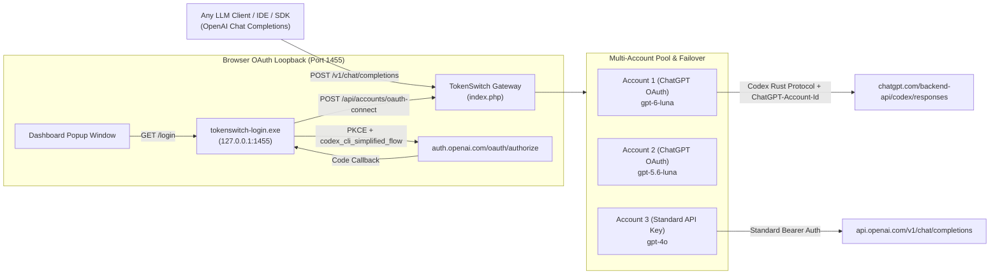

# TokenSwitch

**Multi-Account LLM Token Switcher, Codex Rust Backend Streaming Proxy, and Loopback OAuth Gateway**

TokenSwitch lets you pool multiple OpenAI / ChatGPT accounts (via direct browser OAuth without needing manual paid API keys) as well as standard OpenAI-compatible API keys behind a single unified `/v1/chat/completions` endpoint. It automatically translates standard OpenAI SDK requests into the **Codex Rust Backend (`https://chatgpt.com/backend-api/codex/responses`)**, streams token deltas via Server-Sent Events (SSE) in real time, and rotates across accounts on `429` rate limits or quota exhaustion.

---

## Live Production Deployment

- **Dashboard URL**: `https://tokenswitch.zipperi.com`
- **OpenAI-Compatible Base URL**: `https://tokenswitch.zipperi.com/v1`
- **Chat Completions Endpoint**: `https://tokenswitch.zipperi.com/v1/chat/completions`
- **Primary Default Model**: `gpt-6-luna`

---

## System Architecture



---

## Key Technical Mechanics (For Future Agents & Developers)

### 1. Why Browser Loopback on Port `1455` is Mandatory for OpenAI OAuth
OpenAI's public CLI OAuth Client ID (`app_EMoamEEZ73f0CkXaXp7hrann`) enforces two strict server-side rules on `https://auth.openai.com/oauth/authorize`:
1. **Strict Redirect Whitelist**: The `redirect_uri` **must** be `http://localhost:1455/auth/callback` (specifically port `1455`). Passing a public web domain or any other port causes OpenAI to reject the OAuth callback and redirect the browser to `https://chatgpt.com/auth/login_with?callback_path=/`.
2. **Required Codex CLI Query Parameters**: The authorization URL **must** include:
   - `id_token_add_organizations=true`
   - `codex_cli_simplified_flow=true`
   - `originator=codex_cli_rs`
   - `code_challenge_method=S256` (PKCE)

### 2. How the Popup Login Works (`src/login_tool.rs` & `tokenswitch-login.exe`)
- `tokenswitch-login.exe` is a zero-dependency, multi-threaded Rust loopback server listening on `http://127.0.0.1:1455`.
- When you click **"Login to OpenAI"** on the TokenSwitch web dashboard, `window.open('http://localhost:1455/login', ...)` opens a centered popup window synchronously.
- `localhost:1455/login` generates a PKCE `code_verifier` and `code_challenge` (SHA-256 base64url) and redirects the popup to `auth.openai.com/oauth/authorize`.
- Once the user signs in, OpenAI redirects back to `http://localhost:1455/auth/callback?code=...&state=...`.
- The Rust daemon exchanges the code for an `access_token` and `refresh_token` at `https://auth.openai.com/oauth/token`, extracts the account email from the JWT payload, and syncs the account directly to `POST https://tokenswitch.zipperi.com/api/accounts/oauth-connect`.
- Finally, the popup notifies the parent dashboard via `window.opener.postMessage({ type: 'tokenswitch_oauth_success', email }, '*')` and closes itself automatically.

### 3. Routing ChatGPT OAuth Tokens via the Codex Rust Backend
Tokens obtained via `app_EMoamEEZ73f0CkXaXp7hrann` are ChatGPT subscription/account tokens, **not** paid platform API keys (`sk-proj-...`). Sending them to `https://api.openai.com/v1/chat/completions` results in `401` or `insufficient_quota`.

Instead, TokenSwitch routes `chatgpt_oauth` accounts through the internal Codex Rust backend:
- **Upstream Endpoint**: `POST https://chatgpt.com/backend-api/codex/responses`
- **Required Headers**:
  - `Authorization: Bearer <access_token>`
  - `ChatGPT-Account-Id: <chatgpt_account_id>` (extracted from the JWT claim `https://api.openai.com/auth -> chatgpt_account_id`)
  - `originator: codex_cli_rs`
  - `OpenAI-Beta: responses=experimental`
  - `User-Agent: codex_cli_rs/99.99.99`
  - `Accept: text/event-stream`
- **Supported Codex Models** (discoverable via `GET /v1/models` or `GET /v1/codex/models?client_version=99.99.99`):
  - `gpt-6-luna` (**Primary Default**)
  - `gpt-5.6-luna`
  - `gpt-5.6-terra`
  - `gpt-5.5`
  - `gpt-reserve`
  - `codex-auto-review`
- **Full Reasoning Effort Modes (`minimal`, `low`, `medium`, `high`, `xhigh`, `max`)**:
  - Clients can specify any of the 6 reasoning effort levels (`minimal`, `low`, `medium`, `high`, `xhigh`, `max`) in any of the following ways (in priority order):
    1. **Request Body**: `"reasoning_effort": "xhigh"`, `"reasoning": {"effort": "max"}`, `"effort": "high"`, or `"thinking": {"effort": "low"}`.
    2. **Model Suffix / Alias**: Set `model` to `gpt-6-luna-minimal`, `gpt-6-luna-low`, `gpt-6-luna-medium`, `gpt-6-luna-high`, `gpt-6-luna-xhigh`, or `gpt-6-luna-max` (also supports `:`, `@`, or `/` separators such as `gpt-6-luna:xhigh`).
    3. **Base URL Path / Query / Header**: Use Base URL `https://tokenswitch.zipperi.com/v1/xhigh` (calling `/v1/{effort}/chat/completions` or `/v1/{effort}/responses`), query param `?reasoning_effort=max`, or HTTP header `X-Reasoning-Effort: high`.
    4. **Per-Account Dashboard Default**: Set the default reasoning mode per account on the TokenSwitch dashboard (`POST /api/accounts/{id}/reasoning`).
  - **Upstream Normalization**: When `minimal` is requested, TokenSwitch automatically translates it to Codex's upstream `'none'` mode (since `gpt-6-luna` rejects the literal string `'minimal'`) and exposes `X-Reasoning-Effort: minimal` in the response headers.
- **Multi-Turn Back-and-Forth & Agentic Tool Translation**:
  - Incoming OpenAI `messages` (`system`, `developer`, `user`, `assistant`, `assistant.tool_calls`, and `role: "tool"` outputs) are converted into Codex `instructions`, `message`, `function_call`, and `function_call_output` items.
  - Incoming OpenAI `tools` (`type: "function"`) are automatically converted to Codex `tools` definitions, and upstream `response.output_item.added` (`function_call`) + `response.function_call_arguments.delta` SSE frames are streamed back as standard OpenAI `choices[0].delta.tool_calls` with `finish_reason: "tool_calls"`.
  - Native Codex CLI / Responses API clients calling `POST /v1/responses` directly with `input` receive raw upstream Codex SSE events (`response.created`, `response.output_text.delta`, `response.completed`) untouched.
- **Automatic Server-Side KV Prompt Caching (`cached_tokens`)**:
  - Standard OpenAI SDK clients do not send Codex-specific headers (`session_id`, `x-codex-turn-state`, or `__oailb` gateway affinity cookies).
  - TokenSwitch automatically derives a deterministic UUID v4 `prompt_cache_key` / `session_id` per conversation thread (from the active route, system prompt, first user message, and tool names), or honors explicit `prompt_cache_key` / `session_id` / `x-session-id` headers when provided.
  - On every response, TokenSwitch captures the upstream `x-codex-turn-state` header and OpenAI/Cloudflare load-balancer affinity cookies (`__oailb`, `__cflb`, `__cf_bm`) in `data/turn_states.json` and replays them on subsequent turns of the same conversation.
  - This routes Turn 2+ to the exact same OpenAI edge gateway and GPU worker holding the KV cache, returning `usage.prompt_tokens_details.cached_tokens` (and the `X-Cache-Tokens` response header) automatically.
- **Silent Token Auto-Refresh**:
  - If an access token expires (`HTTP 401`), TokenSwitch automatically calls `POST https://auth.openai.com/oauth/token` with `grant_type=refresh_token` and `client_id=app_EMoamEEZ73f0CkXaXp7hrann`, saves the new JWT to `data/tokens.json`, and retries the request transparently.

---

## Using TokenSwitch in Any Coding Agent, CLI, or SDK

Configure your environment variables or OpenAI client to point to TokenSwitch:

### `.env` / Environment Variables
```env
OPENAI_BASE_URL="https://tokenswitch.zipperi.com/v1"
OPENAI_API_KEY="Its.me@12345"
OPENAI_MODEL="gpt-6-luna"
OPENAI_REASONING_EFFORT="medium" # minimal | low | medium | high | xhigh | max
```

### cURL Example (Streaming + Reasoning Mode)
```bash
curl https://tokenswitch.zipperi.com/v1/chat/completions \
  -H "Authorization: Bearer Its.me@12345" \
  -H "Content-Type: application/json" \
  -d '{
    "model": "gpt-6-luna",
    "reasoning_effort": "xhigh",
    "messages": [
      {"role": "user", "content": "Write a fast binary search in Rust."}
    ],
    "stream": true
  }'
```

### Python (`openai` SDK)
```python
from openai import OpenAI

client = OpenAI(
    base_url="https://tokenswitch.zipperi.com/v1",
    api_key="Its.me@12345",
)

stream = client.chat.completions.create(
    model="gpt-6-luna",
    reasoning_effort="high",  # minimal | low | medium | high | xhigh | max
    messages=[{"role": "user", "content": "Hello from Python!"}],
    stream=True,
)

for chunk in stream:
    print(chunk.choices[0].delta.content or "", end="", flush=True)
```

---

## Repository Structure

| File / Path | Description |
| :--- | :--- |
| [`index.php`](index.php) | Complete production web gateway, solid dark UI dashboard, per-account model switcher, OAuth token auto-refresher, server-side KV prompt cache manager, and Codex Rust SSE translator. |
| [`src/login_tool.rs`](src/login_tool.rs) | Standalone, zero-dependency Rust source for `tokenswitch-login.exe` (multi-threaded loopback OAuth listener on port `1455` with `prompt=login` for multi-account sign-in). |
| [`tokenswitch-login.exe`](tokenswitch-login.exe) | Precompiled Windows binary for the local OpenAI browser login helper. |
| [`login.bat`](login.bat) | One-click Windows launcher for `tokenswitch-login.exe`. |
| [`src/main.rs`](src/main.rs) / [`src/server.rs`](src/server.rs) / [`src/switcher.rs`](src/switcher.rs) | Local Rust Axum server implementation of TokenSwitch. |

---

## Building the Local OAuth Helper (`tokenswitch-login.exe`)

`src/login_tool.rs` uses pure Rust standard library (with built-in SHA-256 and Base64URL for PKCE) so it compiles in 1 second with `rustc` directly:

```powershell
rustc -O src/login_tool.rs -o tokenswitch-login.exe
```

Run in daemon mode (without auto-opening a browser tab on startup):
```powershell
.\tokenswitch-login.exe --no-open
```
Or double-click `login.bat` to start the listener and open the login flow immediately.

---

## API Reference (`index.php`)

| Method & Path | Auth | Description |
| :--- | :--- | :--- |
| `POST /v1/chat/completions` | `Bearer <key>` or Session | Proxies multi-turn chat completion & tool-call requests (streaming & non-streaming) with automatic KV prompt caching and account failover. |
| `POST /v1/responses` | `Bearer <key>` or Session | Native OpenAI Responses / Codex CLI endpoint (`input`, `instructions`, `tools`, `prompt_cache_key`) with raw Codex SSE streaming. |
| `GET /v1/models` | `Bearer <key>` or Session | Returns OpenAI-compatible model list (`gpt-6-luna`, `gpt-5.6-luna`, `gpt-5.6-terra`, `gpt-5.5`, etc.) or proxies native Codex `/models?client_version=...` catalog. |
| `GET /api/status` | Session | Returns current routing strategy (`priority_fallback`, `round_robin`, `least_errors`), active route, and account pool telemetry. |
| `GET /api/export` | `Bearer <key>` or Session | Exports ready-to-use `.env`, JSON, Bash, and PowerShell configuration snippets + live quota & cache telemetry. |
| `POST /api/usage/sync` | `Bearer <key>` or Session | Polls `https://chatgpt.com/backend-api/wham/usage` across all connected Codex OAuth accounts and updates remaining quota %, reset timers, and plan tier. |
| `POST /api/accounts/oauth-connect` | `Bearer <key>` or Session | Registers or updates a ChatGPT OAuth account (`token`, `refresh_token`, `model`, `priority`) and fetches initial quota. |
| `POST /api/accounts/{id}/model` | Session | Updates the target model (`gpt-6-luna`, `gpt-5.6-luna`, `gpt-5.6-terra`, `gpt-5.5`, etc.) for a specific account. |
| `POST /api/accounts/{id}/toggle` | Session | Pauses or resumes an account in the rotation pool. |
| `POST /api/switch` | Session | Forces immediate rotation to the next eligible account. |
| `POST /api/strategy` | Session | Changes the pool routing strategy (`priority_fallback`, `round_robin`, `least_errors`). |
| `POST /api/report` | Session | Simulates or reports an HTTP error (e.g. `429`) on an account to trigger cooldown and failover. |

### Quota, Token Usage & Prompt Cache Telemetry
TokenSwitch tracks **real-time OpenAI Codex quota remaining (%)**, **exact per-account token consumption**, and **KV prompt cache hits (`cached_tokens`)**:
1. **Live Quota Sync (`GET https://chatgpt.com/backend-api/wham/usage`)**:
   - Returns `plan_type` (`free`, `plus`, `pro`, `team`), `used_percent`, `remaining_percent` (`100 - used_percent`), and `reset_at` / `reset_after_seconds`.
2. **Zero-Overhead Inference Header Capture (`x-codex-*`)**:
   - Every `/backend-api/codex/responses` call automatically captures `x-codex-primary-used-percent`, `x-codex-plan-type`, `x-codex-primary-reset-at`, `x-codex-turn-state`, and load-balancer affinity cookies (`__oailb`, `__cflb`) via `CURLOPT_HEADERFUNCTION`.
3. **Exact Token & Cache Counters (`response.completed`)**:
   - Extracts `input_tokens`, `output_tokens`, `total_tokens`, and `input_tokens_details.cached_tokens` from the final `response.completed` SSE frame, returning standard OpenAI `usage.prompt_tokens_details.cached_tokens` to clients and accumulating `total_tokens`, `prompt_tokens`, `completion_tokens`, and `cached_tokens` per account.


